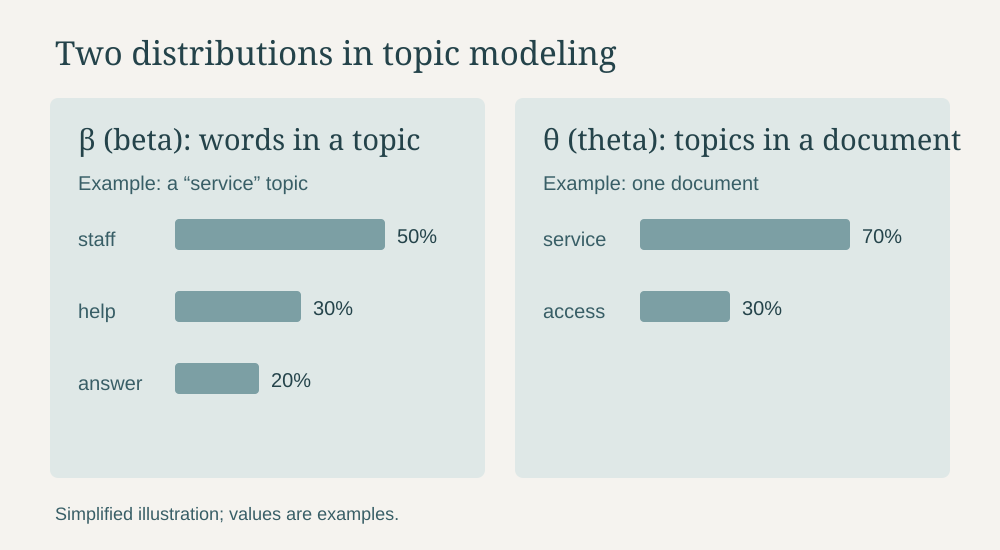

These notes provide a quick reference for key concepts in text mining, sentiment analysis, and topic modeling, including considerations for choosing and interpreting a topic model.

# Text Mining & Sentiment Analysis

## Definitions

($w$) **Word**: a single word. This is the smallest unit of analysis. 

**Text**: written content (aka the words) within a single document. 

($d$) **Document**: a unit of text. 

**Corpus**: the full collection of texts (documents). 

**Stop Words**: common words that don't add much meaning for text analysis. 

($y$) **Covariates**: document attributes.

($v$) **Vocabulary**: a unique set of words from a corpus. 

**N-Grams**: sequence of words we can use to look for corpus themes such as uni-gram (one word), bi-gram (two words), and tri-gram (three words). 

**Sentiment**: emotional tone or attitude expressed in the text. 

# Choosing K

## Definitions

**Topics**: groups of words that tend to appear together and represent possible themes. 

($k$) **Number of Topics**: the number of themes your model should look for, where each topic is a probability distribution over the words. Higher K can capture more nuance but risks redundancy and noise. 

**Exclusivity**: is how unique a topic's top words are to that topic. Higher exclusivity means the words are more distinct, but topics can also get more fragmented. This often trades off with coherence. 

**Semantic Coherence**: measures how often a topic's top words occur together in documents, helping assess whether the words in that topic are related. This tends to decrease as $k$ grows and topics get thinner. 

**Held-Out**: predicts the fit on held out words or unseen data. Higher is better, and you want to look for when K levels out (the elbow). 

**Residuals**: this shows the unexplained variance, and is the difference between predicted and actual values. High residuals suggests missing topics or vocabulary issues. This usually drops fast with K, and then should flatten out. 

## Considerations 

When choosing $k$, the main things to consider are: 

1. Where does held-out mostly plateau?

2. Where do residuals start to flatten out? 

3. Where are exclusivity and coherence both reasonable? 

# Topic Modeling

## Definitions

### ($\beta$) **Distribution of Words in a Topic** ###

The vocabulary (mix of words) that defines a topic.

(How likely a word occurs in a topic.)

$$\beta_{d,k}=P(w_v|k,y_d)$$

The word distribution for topic $k$ is the probability of vocabulary word $w_v$, given topic $k$ and the document-level covariates $y_d$.

### ($z_{d,n}$) **Topic Assignment (per word)**

The topic assigned to a specific word in a specific document. 

(Which topic generated a specific word.)

$$z_{d,n} \in \{1, \ldots, K\}$$

For the $n$th word in document $d$, which topic $k$ generated that word.

### ($\theta$) **Distribution of Topics in a Document**

The mix of topics a document covers. 

(Document d is 70% topic 1 and 30% topic 2. )

$$\theta_{d,k} = P(z = k \mid d)$$

For document $d$, $\theta_{d,k}$ is the probability that a word in that document belongs to topic $k$.

### ($y_d$) Covariate Effect 
Document-level attributes, such as a response date or group, that can help explain differences in how common topics are across documents, the words used to express a topic, or both.

### Latent Variables

Hidden variables that are a part of the model that we do not directly observe, but want to infer. 
